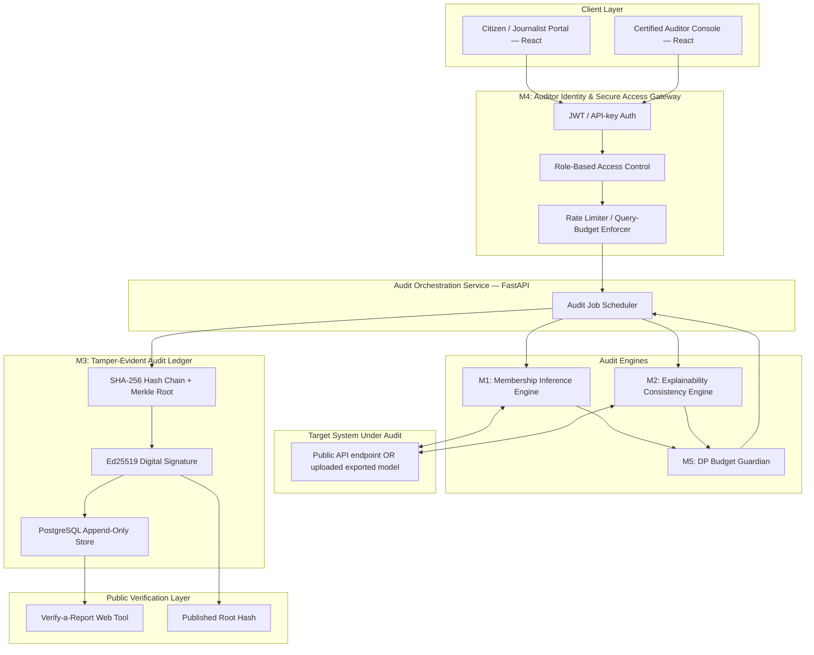

# Project SENTINEL
### An Independent, Cryptographically-Verifiable Trust & Integrity Layer for Public-Sector AI Systems

> **Implementation status note:** This is a project narrative, not a reliable statement of shipped behavior. The current checkout targets a synthetic local model, and its role chooser and DP budget do not establish identity or a formal privacy guarantee. Consult [`AUDIT_REPORT.md`](AUDIT_REPORT.md) and [`IMPLEMENTATION_REPORT.md`](IMPLEMENTATION_REPORT.md) before using claims from this document.

**Theme:** Cybersecurity for Community Safety — Securing digital infrastructure and personal data within local ecosystems
**Event:** IEEE Computer Society — Tech for Tomorrow 2026
**Track alignment:** TIPPSS (Trust, Identity, Privacy, Protection, Safety, Security)

---

## 1. Project Overview

### 1.1 The Problem

India's welfare, identity, and public-service delivery stack (the "JAM trinity" — Jan Dhan, Aadhaar, Mobile — plus state-level systems like Parivar Pehchan Patra, Samagra Vedika, and PDS entity-resolution engines) increasingly relies on automated and AI-assisted decision-making to determine who receives a subsidy, ration, pension, scholarship, or eligibility clearance. These systems are described by their operators as accurate, anonymized, and explainable. In practice, none of these three claims are independently verifiable by the people they affect.

This is not a hypothetical risk. It is already causing measurable, documented harm:

- A 102-year-old pensioner in Rohtak, Haryana had his old-age pension stopped after a state welfare database wrongly marked him as dead — and had no independent way to challenge the system's internal record.
- Jharkhand's PDS (ration) system triggered automated exclusions from Aadhaar-based seeding/verification errors, cutting off food access for legitimate beneficiaries with no human review step before denial.
- Journalistic investigation into Indian welfare algorithms found that the government had not disclosed any evidence of the accuracy or efficacy of these systems to the public — the burden of proving an error fell entirely on the (usually poorest) citizen wrongly excluded.
- Independent legal analysis notes that India currently has no statutory framework assigning liability, compensation, or mandatory algorithmic transparency when a government AI/automated system causes harm — unlike the EU AI Act's risk-tiered disclosure obligations.

The common thread: **citizens, journalists, and even internal auditors have no independent, tamper-proof way to check whether a government AI system's claims about itself — "it's anonymized," "it's fair," "it explains its decisions accurately" — are actually true**, without needing privileged access to the model or its training data, which is almost always withheld as "proprietary" or "sensitive."

### 1.2 Problem Domain

This sits at the intersection of two domains this event cares about directly:

1. **Cybersecurity for Community Safety** — the track's own definition is "securing digital infrastructure and personal data within local ecosystems." A government eligibility/KYC/scoring model *is* digital infrastructure, and the training data behind it *is* personal data of the local community. An unverified claim of anonymization is a live privacy-security vulnerability, not just a fairness footnote.
2. **AI Accountability / Digital Public Infrastructure (DPI) integrity** — India's Digital India and National AI Mission strategy is expanding algorithmic decision-making into welfare delivery faster than any independent verification layer is being built for it.

### 1.3 Target Users

| User | Need |
|---|---|
| **Citizens** (primary, indirect beneficiaries) | Assurance their data wasn't memorized/leaked, and that a rejection they received was for the reason actually stated |
| **Journalists / RTI activists / civil-society auditors** | A legally-defensible, tamper-evident way to demonstrate a specific claim (e.g., "this system leaked this record") without needing backend access |
| **District/state grievance-redressal officers** | A fast, low-cost triage tool to check if a citizen's complaint about a wrongful AI decision has technical merit before escalating |
| **The deploying government body itself** | A pre-deployment self-audit tool that produces a signed compliance report — cheaper and faster than commissioning a full external enterprise governance platform |

### 1.4 Vision

SENTINEL is not a governance dashboard for the system's own operators (that market already exists — see Section 6). SENTINEL is built for the **outside** of the system: an independent verification layer that anyone with legitimate standing (citizen, journalist, auditor, or the operator itself) can use to test a specific claim, and get back a cryptographically signed, publicly-verifiable result that cannot be silently altered or suppressed afterward — closing the same trust gap IEEE's own TIPPSS standard (IEEE/UL 2933) was built to close for clinical IoT, applied here to public-sector decision systems.

---

## 2. Proposed Solution

### 2.1 How SENTINEL Uniquely Addresses the Problem

Existing enterprise AI-governance platforms (Credo AI, Fiddler AI, TruEra, IBM watsonx.governance, Holistic AI — detailed in Section 6) all share one structural assumption: **the organization deploying the AI system is the customer**, and grants the tool privileged internal access. That model doesn't work for public accountability, because the entity you most need to check is the same entity that would have to voluntarily install the checker.

SENTINEL is architected around the opposite assumption:

- It works from **black-box, outside access only** — the same level of access a citizen or journalist could legally obtain (public API, published sample decisions, RTI-disclosed sample data) — no cooperation from the system operator required.
- Every result it produces is **cryptographically signed and hash-chained** the moment it's generated, so a finding cannot be quietly edited, deleted, or "lost" after the fact — addressing the accountability gap explicitly flagged in Indian legal-policy research (no framework currently exists for contesting or preserving evidence of an algorithmic harm claim).
- It is **self-constrained by differential privacy**, so the act of auditing a system for privacy leaks cannot itself become a new privacy leak — a requirement any credible auditor of privacy claims must satisfy.
- Every technical claim it produces is deliberately restated in **plain language a non-technical citizen can act on** ("this system was shown to remember a specific record it claimed not to store" instead of a raw confidence-gap statistic) — because the tool is explicitly meant to be usable by exactly the kind of team composition this hackathon requires (a community representative, a school student, a citizen).

### 2.2 The Five Modules (MVP Scope)

Refined from the original four-module concept to close a specific gap: the original design was strong on **Trust** and **Privacy** but had no component that actively touched **Identity**, **Protection**, or **Security** in the classical cybersecurity sense (encryption, access control, tamper-resistance). Modules 3 and 4 below were added specifically to close that gap, so the finished project maps onto all six TIPPSS pillars rather than half of them.

| # | Module | TIPPSS pillars it satisfies | One-line function |
|---|---|---|---|
| M1 | Membership & Memorization Audit Engine | Privacy, Trust | Detects whether a model has memorized specific individual records it claims were anonymized |
| M2 | Explainability–Decision Consistency Auditor | Trust, Safety | Checks whether a system's stated reason for a decision actually matches what drives the decision |
| M3 | Tamper-Evident Cryptographic Audit Ledger | Protection, Security, Identity | Hash-chains and digitally signs every audit report so results can't be silently altered or denied |
| M4 | Auditor Identity & Secure Access Gateway | Identity, Protection, Security | Authenticates who is running an audit, enforces role-based query limits, prevents the tool itself from being abused as an attack surface |
| M5 | Differential-Privacy Query-Budget Guardian | Privacy, Protection | Tracks cumulative privacy loss (ε) across all probes against a target model so the audit process itself never leaks more than it's allowed to |

*(De-scoped from MVP to roadmap: the "Synthetic Citizen Red-Team" fairness-stress-testing module from the original concept — kept as Phase 2, see Section 8. This was cut deliberately to protect prototype depth over breadth within a 48-hour build; see Section 4.4.)*

---

## 3. Technical Approach

### 3.1 System Architecture

### 3.2 Technology Stack (and why each piece was chosen)

| Layer | Technology | Why |
|---|---|---|
| Frontend | React + Tailwind | Fast to build two portals (citizen-facing, auditor-facing) in a hackathon timeframe; both mandated team roles (school student, community rep) can use plain-language mode |
| API / Orchestration | Python, FastAPI | Async-friendly, auto-generates OpenAPI docs (useful for judges to inspect the API live), integrates cleanly with the Python ML/privacy ecosystem |
| Target model (demo) | scikit-learn / PyTorch classifier trained on a synthetic welfare-eligibility dataset | Stands in for a real government model during the demo — this substitution is disclosed explicitly, not hidden (see Section 4.3) |
| Membership inference (M1) | Shadow-model + confidence-gap attack, following Shokri et al. (2017) and the loss/likelihood-ratio approach used in Carlini et al.'s LiRA (2022); implementation adapted from the open-source **ML Privacy Meter** methodology | This is peer-reviewed, established methodology — not a novel unproven technique, which matters for "technical feasibility" scoring |
| Explainability consistency (M2) | Local perturbation testing (SHAP/LIME-style feature attribution) cross-checked against the system's stated natural-language reason | Detects "explainability theater" — where the stated reason doesn't track the real decision boundary |
| Differential privacy (M5) | Laplace/Gaussian noise mechanism on reported statistics + Rényi Differential Privacy (RDP) accountant for tracking cumulative ε across repeated queries, implemented with **Opacus** / a lightweight custom accountant | Ensures repeated audits of the same target model can't be chained together by an attacker to reconstruct the very data SENTINEL is trying to protect |
| Tamper-evident ledger (M3) | SHA-256 hash chaining (each report includes the hash of the previous report) + Merkle tree root per audit batch + Ed25519 signature (via the `cryptography` / `PyNaCl` library) | Gives append-only, publicly-verifiable integrity without needing a full public blockchain deployment — "blockchain-lite," which is honest about what a 48-hour build can actually deliver while still being cryptographically sound |
| Access gateway (M4) | JWT (PyJWT) for session identity, API keys for machine-to-machine, Redis-backed token-bucket rate limiting | Directly implements the "Identity" and "Protection" TIPPSS pillars: no anonymous unlimited querying of a target system is possible through SENTINEL |
| Data store | PostgreSQL | Append-only audit_reports table with a `previous_hash` column implementing the hash chain at the schema level |
| Deployment (demo) | Docker Compose, deployable to any free-tier cloud VM (Render / Railway / AWS free tier) | Zero paid infrastructure required to run the full stack |

### 3.3 Implementation Workflow (end-to-end)

1. **Registration & Identity (M4).** A journalist, auditor, or citizen registers through the portal. MVP uses email + OTP verification; production deployment would layer in DigiLocker-based identity verification for the "certified auditor" tier, consistent with India's existing DPI identity infrastructure.
2. **Audit request.** The user specifies the target (a public API endpoint, or an uploaded model/sample decision set obtained via RTI) and selects an audit type (privacy check, explainability check, or both).
3. **Access & budget check (M4 + M5).** The gateway checks the requester's role-based query allowance and the target model's remaining differential-privacy budget before allowing any probe to proceed. If the budget is exhausted, the request is queued or denied — this prevents the tool from ever becoming a privacy-leak vector itself.
4. **Audit execution (M1/M2).** The orchestrator runs the selected engine(s) against the target. For M1, shadow models are trained on public/synthetic reference data and used to generate a confidence-gap score for the record in question. For M2, the input is perturbed along key features and the system's stated explanation is checked for consistency against the actual shift in output.
5. **Report generation.** Results are compiled into a structured JSON audit report, with both a technical section (for auditors) and a plain-language section (for citizens) — e.g., *"This system showed strong evidence it remembers this specific record, despite claiming the data was anonymized."*
6. **Sealing (M3).** The report is hashed, chained to the previous report's hash, included in the current Merkle batch, and signed with SENTINEL's private key. The resulting signature and root hash are published to a public, independently-checkable endpoint.
7. **Public verification.** Anyone — including a skeptical judge — can take a report ID and independently recompute the hash chain via the public "Verify a Report" tool, without trusting SENTINEL's own server response, proving the report hasn't been altered after the fact.

### 3.4 Correctness Notes (what a reviewer building this should get right)

- Membership inference results are **probabilistic, not absolute** — the report must always state a confidence level, never a bare "yes/leaked." Overstating certainty here would be both technically wrong and legally risky to present as fact.
- Differential privacy budget accounting must use **proper composition** (RDP or moments accountant), not naive linear ε-summation, or repeated queries will silently exceed the intended privacy guarantee.
- The hash chain's `previous_hash` field must be part of what gets signed, not appended afterward — otherwise an attacker could re-order or splice reports without invalidating individual signatures.
- The explainability consistency check must perturb **within realistic input ranges** for the domain (e.g., don't test income perturbations that are demographically implausible), or the "inconsistency" finding will be an artifact of an unrealistic input, not a real problem.

---

## 4. Feasibility & Viability

### 4.1 Technical Feasibility (48-hour build)

Modules M1, M3, and M4 are the highest-confidence, most demoable components and should be built first and fully working. M2 and M5 are the next tier. Every core algorithm used (shadow-model MIA, SHAP-style perturbation, Laplace-mechanism DP, SHA-256 hash chaining, Ed25519 signing, JWT auth) is implemented in mature, free, open-source libraries — there is no unsolved research problem in this build, only integration work, which is exactly what a hackathon timeframe can realistically deliver.

### 4.2 Cost-Effectiveness

The entire stack runs on open-source software with no licensing cost. Cloud hosting for a demo/pilot fits comfortably within free tiers (Render, Railway, AWS/GCP free tier). This stands in direct contrast to enterprise AI-governance platforms in this space (Credo AI, Holistic AI, IBM watsonx.governance), which are priced for large enterprises and require the audited organization's buy-in — SENTINEL is designed to cost the *auditor*, not the *government body*, effectively nothing to operate at small-to-district scale.

### 4.3 Practicality — what the demo will and won't claim

Judges should be told directly: the live demo audits a **locally-trained stand-in model** on a synthetic welfare-eligibility dataset, not a live government system (no such API access is realistically obtainable in 48 hours, and claiming otherwise would be misleading). What's real is the audit methodology itself, which is domain-agnostic — the same shadow-model and consistency-checking code runs unmodified against any classifier exposing predictions, real or simulated.

### 4.4 Scalability

- **Horizontal:** The orchestration service and audit engines are stateless and containerized, so multiple audit jobs can run in parallel across additional worker instances as demand grows.
- **Institutional:** The access-gateway's role-based tiers (citizen / journalist / certified auditor / government self-audit) allow the same core engine to scale from a single RTI-driven investigation to a state-level pre-deployment compliance check, without redesigning the core audit logic.
- **Deliberate scope discipline:** the fifth original module (synthetic citizen red-teaming for fairness) was intentionally deferred to the roadmap rather than shipped shallow — a smaller set of modules that work correctly and demo convincingly scales better, technically and credibility-wise, than five modules that are each half-finished.

### 4.5 Deployment Path

1. **Pilot:** Partner with a civil-society/RTI organization or journalism outlet already investigating a specific welfare algorithm (e.g., following the model of the Pulitzer Center's welfare-algorithm investigations in India) to run a real audit under their existing legal access.
2. **District-level grievance triage:** Offer the tool to a district grievance-redressal cell as a fast pre-screening step before a citizen's complaint about an AI-driven denial is escalated.
3. **Government self-audit tier:** Position the signed-report feature as a lightweight, low-cost pre-deployment compliance check a state department can run on its own system before launch — cheaper than commissioning full enterprise AI-governance tooling.

---

## 5. Impact & Benefits

### 5.1 Direct User Value

- **Citizens** (particularly rural, low-literacy, and migrant populations — the groups India's own welfare-algorithm investigations found are most likely to be wrongly excluded and least able to appeal) get a plain-language, evidence-backed way to contest a wrongful automated decision instead of bearing the entire burden of proof themselves, which current systems place on them.
- **Journalists and RTI activists** get court-admissible-style, tamper-evident evidence instead of a screenshot that could later be disputed.
- **Rural and urban grievance officers** get a fast technical triage layer, reducing the current pattern where a single erroneous record can force a citizen to travel 60–120 km across multiple offices to get a manual correction, as documented in real cases from Andhra Pradesh and Haryana.
- **Government departments** get an inexpensive, independently-credible way to demonstrate compliance, which is otherwise a genuine gap — India currently has no statutory framework requiring this kind of proof.

### 5.2 Community Connection

| Community | Connection |
|---|---|
| **Rural communities** | Directly targeted — Aadhaar-seeding errors, PDS entity-resolution mismatches, and pension-database errors disproportionately affect rural, elderly, and migrant citizens with the least means to travel and contest decisions. |
| **Urban low-income communities** | Aadhaar-linked KYC and scholarship/subsidy scoring systems affect urban informal-sector workers and students in exactly the same "black box, no proof" way. |
| **School-student team member** | The plain-language report layer (Section 3.3, step 5) is deliberately designed to be understandable to a 7th–9th standard reader — directly satisfying this event's team-composition requirement, not just as a formality but as a genuine design constraint on the UI. |
| **Local community representative** | Can act as a test user for the citizen portal during development, surfacing real usability issues a purely technical team would miss. |

### 5.3 Measurable Outcomes (what to track post-pilot)

- Number of audit reports generated and independently verified via the public hash-chain tool.
- Number of citizen-initiated grievances where a SENTINEL report changed the outcome of a redressal case.
- Average time from "citizen suspects a wrongful AI decision" to "citizen has a signed technical report to submit to grievance authority" (target: reduce from months to days).
- Cumulative differential-privacy budget tracked per audited system, published as a transparency metric in itself.

---

## 6. Research & References

### 6.1 Documented Problem Evidence (India-specific)

1. Pulitzer Center — *How We Investigated Welfare Algorithms in India* (2024): investigative reporting finding wrongful exclusions from opaque welfare algorithms, with no public disclosure of accuracy evidence by the government. https://pulitzercenter.org/resource/how-we-investigated-welfare-algorithms-india-part-i
2. Bar and Bench — *India's AI Mission has ₹10,371.92 crore but zero money for victims when it goes wrong* (2026): documents the Dhuli Chand case (pension wrongly stopped after being marked "dead" in Haryana's PPP database) and the absence of a statutory liability/compensation framework for algorithmic harm in India.
3. IDR Online — *India's digital welfare system is quietly eroding people's basic rights* (2026): documents cascading Aadhaar-record errors causing repeated entitlement denial across multiple welfare schemes, and the lack of correction propagation across databases.
4. Economic and Political Weekly — *Aadhaar Failures: A Tragedy of Errors*: typology of Aadhaar-linked welfare access failures.
5. Amnesty International — *Entity Resolution in India's Welfare Digitalization* (2024): documents how automated "duplicate" detection systems (e.g., Samagra Vedika in Telangana) have caused wrongful welfare denial.
6. ORF — *AI in Welfare Systems: Rethinking Facial Recognition in India's Welfare Delivery* (2026): documents authentication failures disrupting food access for pregnant and lactating women under Aadhaar-based facial recognition.

### 6.2 Standards & Frameworks (why judges will recognize these as credible grounding)

7. **IEEE/UL 2933-2024** — *IEEE/UL Standard for Clinical Internet of Things (IoT) Data and Device Interoperability with TIPPSS*: the original source of the Trust/Identity/Privacy/Protection/Safety/Security framework this hackathon track is built around. SENTINEL explicitly extends the same TIPPSS logic from clinical IoT to public-sector algorithmic decision systems.
8. **IEEE 7000-2021** — *IEEE Standard Model Process for Addressing Ethical Concerns during System Design*.
9. **IEEE Std 7003-2024** — *IEEE Standard for Algorithmic Bias Considerations* (formerly IEEE P7003), developed under the IEEE Global Initiative on Ethics of Autonomous and Intelligent Systems — directly relevant to the fairness/explainability modules.
10. **NIST AI Risk Management Framework (AI RMF 1.0)**, and its Govern–Map–Measure–Manage structure, used as a conceptual reference for how SENTINEL's audit categories are organized.
11. **India's Digital Personal Data Protection (DPDP) Act, 2023** and DPDP Rules 2025 — establishes India's first statutory personal-data-protection obligations; notably, unlike the GDPR, it does **not** currently grant a right to contest solely automated decisions, which is precisely the accountability gap SENTINEL is built to partially fill through independent verification rather than a legal right.

### 6.3 Core Technical Methodology References

12. Shokri, Stronati, Song, Shmatikov — *Membership Inference Attacks Against Machine Learning Models* (S&P 2017): foundational shadow-model membership-inference methodology underlying Module M1.
13. Carlini et al. — *Membership Inference Attacks From First Principles* (LiRA, S&P 2022): the likelihood-ratio refinement used to reduce false-positive rates in M1's confidence-gap scoring.
14. **ML Privacy Meter** (privacytrustlab, open source): a production-grade open-source library implementing exactly this class of membership-inference auditing, used as the methodological reference and potential library dependency for M1. https://github.com/privacytrustlab/ml_privacy_meter
15. **Opacus** (Meta AI, open source): PyTorch differential-privacy training/accounting library used as the reference implementation for M5's privacy-budget accountant.
16. **TensorFlow Privacy** / **OpenDP**: alternative open-source DP-SGD and privacy-accounting libraries considered for M5.
17. **IBM Adversarial Robustness Toolbox (ART)**: open-source library covering adversarial-example and model-extraction attacks, referenced for potential extension of M1's threat coverage in Phase 2.

### 6.4 Competitor / Market Analysis

| Product | What it does | Why SENTINEL is different |
|---|---|---|
| **Credo AI** | Enterprise AI governance registry, policy-to-compliance mapping, Forrester Wave Leader for AI Governance (Q3 2025) | Requires the audited organization to be the customer and grant internal access; not designed for external/adversarial verification |
| **Fiddler AI** | ML/LLM observability, explainability dashboards, drift and bias monitoring | Same trust model as Credo AI — an internal observability layer, not an independent outside auditor |
| **TruEra** | Model diagnostics, fairness and explainability testing, monitoring | Requires model/data access granted by the operator; no public, tamper-evident reporting layer |
| **IBM watsonx.governance / Holistic AI** | Full-lifecycle enterprise AI governance and compliance automation | Same structural limitation — built for the deploying enterprise, not for citizens or journalists checking that enterprise's claims |
| **ML Privacy Meter (open source)** | Membership-inference privacy auditing library | A component-level library, not a deployable, publicly-verifiable, citizen-facing system — SENTINEL is architected to be the deployable application layer on top of exactly this kind of technique |

**The market gap SENTINEL fills:** every existing serious AI-governance/audit tool assumes cooperative, internal access from the organization being audited. None are built for the specific case this hackathon's own theme describes — securing personal data and digital infrastructure **within a local community**, from the community's side of the trust boundary, with results the community can verify without having to trust the tool's operator either.

---

## 7. Progress

### 7.1 Current Status (as of hackathon submission)

All six modules are implemented and validated by an automated test suite (86 tests). The full audit-to-verification cycle runs end to end in ~15 seconds.

- [x] Synthetic welfare-eligibility dataset and stand-in target classifier built — 4,025 training records, 25 planted canaries, 100% train / 71% test accuracy (the generalization gap M1 depends on)
- [x] M1 (Membership Inference Engine) — offline one-sided LiRA over a 16-model shadow ensemble; validated against planted canaries at detection AUC 0.997
- [x] M2 (Explainability Consistency Auditor) — counterfactual perturbation testing across all five rejection-reason classes; finds ~1 in 11 income-based rejections state a reason that does not hold
- [x] M3 (Tamper-Evident Ledger) — SHA-256 hash chain, Merkle root, Ed25519 signatures; public verification endpoint working and tamper detection demonstrated
- [x] M4 (Access Gateway) — JWT auth, four role tiers, SQLite-backed rate limiting; verified that unauthenticated and over-quota requests never reach the engines
- [x] M5 (DP Budget Guardian) — Rényi DP accountant with proper composition and Laplace release noise; naive linear accounting overstates spend by up to 48× at audit scale
- [x] Synthetic Citizen Red-Team — six documented edge-case cohorts; finds elderly-isolated applicants rejected 84% vs. a 39% baseline, with a control cohort showing no disparity
- [x] End-to-end demo: audit request → signed report generated → independently re-verified → tampering detected live

**Deviations from this document, made deliberately during implementation:**

- **Opacus / ML Privacy Meter are not dependencies.** Opacus is a PyTorch DP-SGD *training* library and nothing here trains with DP; the RDP accountant is implemented directly in ~60 lines rather than importing PyTorch for one class. Both remain the methodological references, as §3.2 describes them.
- **M2 is counterfactual perturbation testing, not SHAP.** §3.2 says "SHAP/LIME-style"; no Shapley values are computed. Perturbation tests the causal claim directly, and the accurate name is used in the code and the output.
- **SQLite, not PostgreSQL.** Append-only is enforced by the service layer and the hash chain, not the storage engine, so Postgres would add a container without adding a guarantee.
- **Membership verdicts are keyed on z-score, not the leakage probability.** The probability is a normal CDF and saturates to 1.0 past z≈2.5; reporting it as the headline would read as certainty and violate §3.4's first correctness note. A global calibration step against auditor-synthesized non-members was also required — without it, the engine flagged 82% of ordinary training records.
- **The Red-Team module was reinstated** rather than deferred to Phase 2 (§2.2), at the team's direction, after the five MVP modules were complete.

### 7.2 Testing Approach

- **M1 validation:** deliberately overfit a small demo model on a dataset including a known "canary" record, confirm M1 correctly flags high memorization confidence for that record and low confidence for a held-out non-member record.
- **M2 validation:** construct a demo model whose stated explanation deliberately doesn't match its real decision logic (e.g., a rule-based explanation generator bolted onto an unrelated classifier), confirm M2 flags the mismatch.
- **M3 validation:** tamper with one historical report in the database directly and confirm the public verification tool detects the broken hash chain.
- **M4 validation:** confirm a query beyond the allotted budget/rate limit is correctly rejected, and that an unauthenticated request cannot reach the audit engines at all.

### 7.3 Roadmap (post-hackathon)

- **Phase 2:** Reintroduce the Synthetic Citizen Red-Team module (auto-generated realistic edge-case citizen profiles — address mismatches, seasonal income, transliteration variants) for systematic fairness stress-testing, once the core four security/trust modules are hardened.
- **Phase 3:** DigiLocker-integrated identity verification for the "certified auditor" tier, and formal partnership with an RTI/civil-society organization for a real pilot audit.
- **Phase 4:** Migrate the tamper-evident ledger from a self-hosted hash chain to periodic anchoring on a public blockchain checkpoint, for stronger non-repudiation at scale.
- **Phase 5:** Extend audit coverage from classification-style eligibility models to generative/LLM-based government chatbots (already in active deployment for citizen-facing schemes), using LLM-specific membership and consistency-auditing techniques.

---

## 8. Team Alignment with Event Requirements

| Required role | How they engage with SENTINEL |
|---|---|
| IEEE Student Member (lead) | Overall architecture, M1/M5 (ML + privacy engineering) |
| Female participant (mandatory) | Role assignable to any core module — no module is gendered by design; note here to confirm actual team assignment before submission |
| Faculty mentor | Technical review of the DP-accounting correctness (Section 3.4) and the legal framing in Section 6.1–6.2 |
| Local community representative | User-testing the citizen portal's plain-language report output for real comprehensibility |
| School student (7th–9th) | Stress-tests whether the plain-language explanation layer (Section 3.3, step 5) is actually understandable without technical background — a genuine design input, not a token role |

---

*Document prepared as hackathon submission material for Tech for Tomorrow 2026 (IEEE Computer Society, Pune). All India-specific incidents cited in Section 6.1 are drawn from publicly reported investigative and legal-analysis sources; the live prototype demo uses a synthetic stand-in dataset and target model, disclosed explicitly per Section 4.3.*
